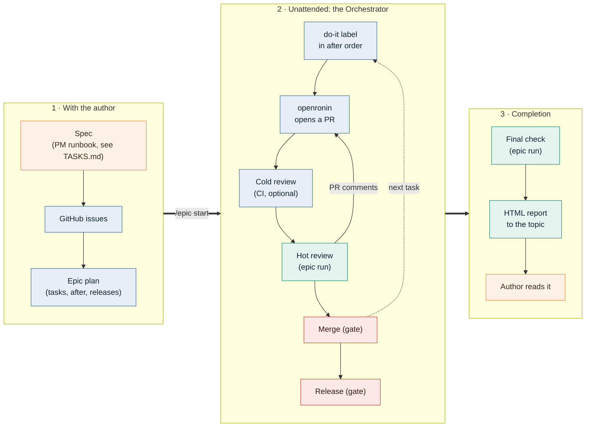
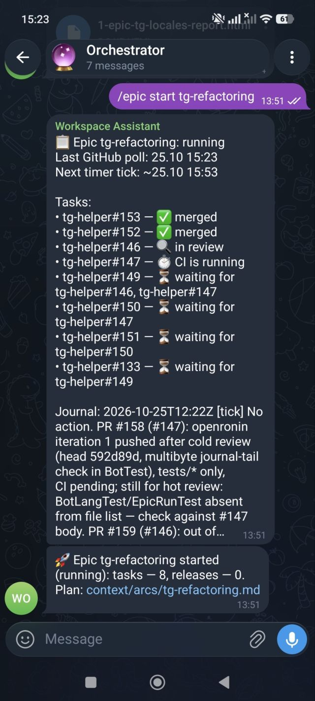
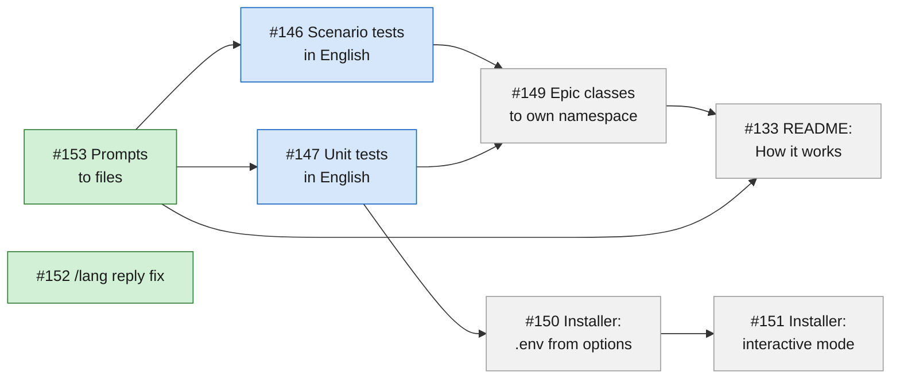
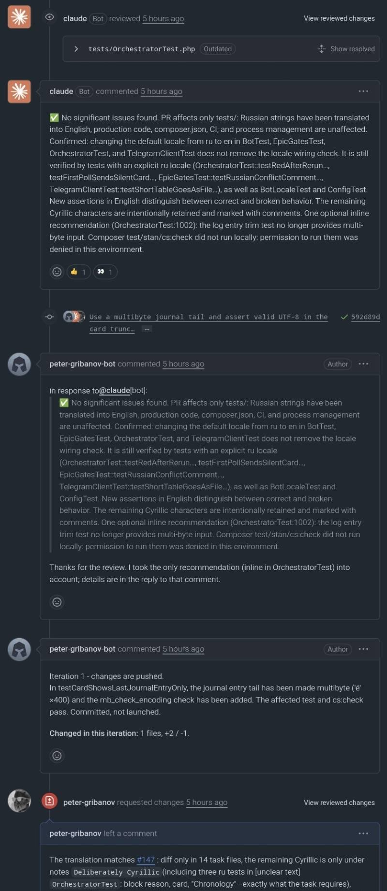

# Epics

An epic is an author-approved set of GitHub tasks (openronin issues) with an execution order. The
bot stores the epic, parses its plan and queues **isolated Claude runs** with a signal; the
`Orchestrator` decides when a run is needed and performs the deterministic steps itself. The bot
stays thin: judgement calls (review, answers, follow-up tasks, forks, the final report) are made by
Claude following `prompts/epic_runbook.md.dist` (or a local `prompts/epic_runbook.md`) from the bot's repository (its absolute path is passed
in the prompt).

This document is the reference for **when the bot merges and releases on its own**. Read it before
changing `Epic\Gates`, `Epic\MergeGate` or the `Orchestrator`.

## How an epic runs

From design with the author to the final report, the epic goes through three stages:



How the task text and the issues of stage 1 are produced is shown in [Working out a task](TASKS.md).

## The plan is a dependency graph

- **Parallel by default.** Every task whose dependencies are met is handed over in the same pass, so
  independent tasks are implemented, reviewed and merged side by side (in the card below one task is
  in review while another one's CI is running).
- **Dependencies are enforced.** A task with `after` is not started until every task it depends on is
  merged, also across repositories (`frontend#3` after `backend#12`); a contract release waits for its
  `after` tasks the same way. A cycle in the plan is rejected at `/epic start`.
- **Problems stay local.** A red `master` pauses merges and releases of that repository only, and
  `hold` parks a single task; the rest of the epic keeps going.

<p align="center">
  
  <br>
  <em>The epic card is one message the bot keeps up to date: each task's state, what it waits for, and the last journal entry.</em>
</p>

The plan of that epic, as a graph (states as in the screenshot). #152 depends on nothing and was merged
alongside #153; #146 and #147 started together as soon as #153 was merged; #149 waits for both of them,
while the installer branch (#150 → #151) only needs #147:



Green — merged, blue — in progress (review, CI), grey — waiting for dependencies.

Before the bot merges a pull request of an epic, it goes through the hot review with the epic's context; if a
cold CI reviewer is set up, its findings come first and the hot review gives each of them a verdict. openronin
answers the findings and pushes fixes:

<p align="center">
  
  <br>
  <em>Cold review recommendation → openronin's fix → hot review with the epic's context.</em>
</p>

## GitHub owners

`GITHUB_OWNERS` in `.env` is a comma-separated list of owners; the first one is the default owner.
A task in the plan is `owner/repo#N` or the short `repo#N` (default owner); `releases[].repo` is
`owner/repo` or `repo`. PR links in the `review` mode are recognised for all listed owners. Stored
`repo#N` values stay valid without migration. While `GITHUB_OWNERS` is unset, epics and PR link
recognition fail with "set GITHUB_OWNERS".

## Marker authors

The epic marker `<!-- epic:<slug> -->` counts only when it comes from the `gh` account the bot runs
as (the login is read from `gh api user` once per process). The `<!-- openronin:bot -->` marker
counts only from logins listed in `OPENRONIN_LOGINS` (comma-separated, case-insensitive). When the
variable is unset, the marker is accepted from any author and the bot logs one warning at startup.
A comment or review carrying a marker from any other author is treated as a foreign action.

## Commands

The forum topic is created by the author; the bot does not create topics and does not need the
`can_manage_topics` right.

| Command              | Action |
|----------------------|--------|
| `/epic start <slug>` | Start the epic in this topic (status `running`). An invalid plan is rejected with the reason and no epic is created |
| `/epic pause`        | Pause (`paused`) |
| `/epic resume`       | Clears `paused` and `blocked` on the epic and `blocked` on tasks (including on a `running` epic when the reply names tasks). For the unblocked tasks the `REQUEST_CHANGES` ceiling counter and `conflict_head` are reset: the author answered in the topic (a chat run recorded the decision in the journal) and explicitly resumed the epic. It also resets the stagnation counter (`stale_ticks = 0`, the last-activity moment is set to now), so the next timer tick comes `EPIC_TICK_MINUTES` after the resume (ticks driven by attention are immediate), and the merge gate's `merge_failures` counters |
| `/epic status`       | State of the topic's epic: status, tasks, hold, blocked, time of the last GitHub poll, journal path |
| `/epic`              | Without an argument: a keyboard of the actions that apply to the topic's epic now, under the same conditions as the text commands: pause if the epic is neither `paused` nor `done`; resume if the epic is not `done` and is either not running or has blocked tasks; status whenever the topic has an epic (including `done`); start if the topic has no epic or it is `done`, and there are plans that can be started. Start takes two steps: a plan list, then a confirmation. The list holds `EPICS_DIR/*.md` files that are not journals, have a valid slug and have no epic yet, new ones first, at most 10; if the chosen plan is invalid, the bot shows the error and no start button. A button whose `callback_data` would exceed Telegram's 64 bytes is not shown; if it is a plan in the list, a hint is printed under the list; with a long slug such actions are available only as text commands. With no buttons left, `/epic` replies with `epic.nothing_to_do` and `epic.usage` below it. Every press re-reads the state: a stale keyboard gets only a toast when the topic no longer has that epic (none or another one), or when start is no longer possible at the list or plan-choice step; otherwise the reply is the same as for the matching text command |

The text forms `/epic start|pause|resume|status` work as described above.

`/cancel` in an epic topic drops the epic's queue items and puts the epic on pause.

Epic statuses: `running | paused | blocked | done`. Storage: tables `epics`, `epic_tasks` (task set:
plan + `added`, `hold`, status, gate counters) and `epic_releases` in `state/state.sqlite`.

## Status card

Each epic topic has one **status card** (`Epic\Card`): a message the bot sends silently on
`/epic start`, tries to pin (`pinChatMessage`; without the right it silently stays unpinned) and then
edits in place (`editMessageText`, no notification). Questions, a stop (`blocked`) and the report
arrive as separate messages with sound and are not folded into the card.

The card shows: the epic status; the time of the last successful GitHub poll (a sign the bot is
alive; refreshed in the text at most once per 5 minutes); one line per task (plan + `added`) with its
stage (waiting for `after`, `hold`, openronin working, waiting for an answer, draft / CI, review,
changes after review, approved, merged, `blocked`); the last entry of the "Timeline" section of the
journal `<EPICS_DIR>/<slug>.journal.md` (up to ~300 characters; no journal, section or items — "the
journal is still empty"); and the next timer tick time (for `running`). Stages are computed from the
state the poll already collected and the `epic_tasks` rows; the card makes no new GitHub requests.

The card is edited on every successful poll (after an epic run, bot actions and a stage change — on
the nearest one) and immediately when the epic moves to `paused` / `blocked` / `done`; if the final
text is unchanged, no edit is sent. If the card was deleted (Telegram answers "message not found"),
the bot sends a new one silently. `message_id` and the poll time are stored in the columns
`card_message_id` and `last_poll_at` of `epics`.

## Plan

The file `<slug>.md` in the plans directory inside `REPO_PATH` (`EPICS_DIR`, default
`.workspace-assistant/epics/`). The plan is JSON in the first fenced `json` block:

```json
{
  "tasks": [
    {"task": "backend#12"},
    {"task": "frontend#3", "after": ["backend#12"]}
  ],
  "releases": [
    {"repo": "backend", "version": "v1.2.0", "after": ["backend#12"]}
  ]
}
```

- `task` — `owner/repo#N` or `repo#N`;
- `after` — dependencies (optional); they may reference only tasks from the plan, a cycle is an error;
- `releases` (optional) — a contract release: `repo`, `version` (like `vX.Y.Z`, as the repositories'
  tags) and a non-empty `after` are required.

The block is parsed with `json_decode` (no YAML: the bot has no runtime dependencies). The plan must
be in the `REPO_PATH` working tree at the time of `/epic start`.

## Journal

`<EPICS_DIR>/<slug>.journal.md` in `REPO_PATH`. The journal is the epic's only memory between runs;
the Claude runs maintain it themselves (commit and push right after every external action). With
`AUTO_COMMIT=0` they write it to disk without committing or pushing it. The bot then shows the journal
as a local path, while the plan link still points to GitHub and may return 404 until the operator
pushes the plan.

## Epic run: input and signal

Run kinds: `tick` and `final` (the final check) run in the `pm` mode; `review` (hot review of a PR)
runs in `review`. They are queued by `QueueScheduler::enqueueEpicRun($slug, $run, $pr)`.

**Input** is the prompt: `slug`, plan path, journal path, absolute runbook path, outbox path, run
kind and the **epic marker** `<!-- epic:<slug> -->`, which goes into the review body (hot review) or
into every issue/PR comment the run publishes (tick, including the comment answering an openronin
clarification). The marker distinguishes epic actions from the author's manual actions — both work
under one GitHub account.

**Output** is the signal file `state/epics/<slug>/signal.json`; its path is passed to the process in
the environment variable `WORKSPACE_ASSISTANT_EPIC_SIGNAL`. A JSON object, all fields optional (no
field — no change); an empty `{}` is valid:

| Field           | Format | What the bot does |
|-----------------|--------|-------------------|
| `added`         | `[{"task": "repo#N", "after": ["repo#M"]}]` | tasks are added to the epic set (existing ones are untouched) |
| `hold`          | `["repo#N"]` — the full current list | marks the tasks (clears the others); `[]` clears all |
| `message`       | string | sent to the epic topic |
| `blocked`       | string — the reason | the epic becomes `blocked` (see below); stronger than `done` |
| `done`          | `true` | the epic becomes `done`; the outbox report is already in the topic |
| `verdict`       | `approve` \| `request_changes` | `review` run: the published verdict (required, see "Cold reviewer findings") |
| `cold_findings` | `[{"id": "C1", "verdict": "fixed\|open\|refuted", "where": "…"}]` | `review` run: a verdict for every cold reviewer finding |

`after` of `added` and every `hold` task must belong to the epic set (or to the same `added`). An
invalid or missing signal is a **run failure**: the bot reports it in the topic and applies nothing
from the signal. The text reply of an epic run is not sent to the topic; the author receives only
`message`, `blocked` and the report. Files in the run's `state/outbox` go to the epic topic as for a
regular run.

## Cold reviewer findings in the hot review

The cold reviewer (`claude[bot]`, `claude-review.yml`) writes mostly inline, and
`gh pr view --comments` does not show inline comments, so completeness is guaranteed by code rather
than by the model's memory:

1. **Collection** (`GhClient::coldFindings`, REST only, paginated). Before queueing a `review` run
   the bot collects everything `claude[bot]` left: `pulls/{n}/comments` (inline, with file and
   line), non-empty bodies of `pulls/{n}/reviews`, and `issues/{n}/comments`. Comments of humans and
   openronin are excluded. Findings get ids `C1…CN`. The list together with the head the review runs
   on is written to `state/epics/<slug>/cold-<repo>-<n>.json`; signal handling reads this file and
   nothing is re-collected at the end.
2. **Prompt.** The `review` run prompt contains the findings with ids and texts and requires a
   report on each; with no findings it says explicitly "no cold reviewer findings".
3. **Signal.** `verdict` is the published verdict (`approve` | `request_changes`); `cold_findings`
   is a verdict per id: `fixed` (`where` is the place in the diff, verified against the code and not
   against openronin's "addressed" reply), `open` (not fixed), `refuted` (refuted by the run's own verification).
4. **Coverage check.** The run fails when at least one id from the saved list has no verdict, when
   `verdict` is `approve` while at least one finding is `open`, or when `verdict` is missing. On full
   coverage the bot writes the task counter `coverage_head` = the head from the saved file.
5. **Retry.** After a coverage failure the bot resets `reviewed_head` and sets `cold_retry` = head:
   the orchestrator queues a repeated review of the same head (even if an epic review on it is
   already published). At most 2 attempts per head (counter `cold_attempts`); after the second the
   task becomes `blocked` and a question listing the uncovered ids goes to the topic.
6. **Merge gate** (steps 2 and 4 of the merge gate below) merges only if the head is accepted:
   `coverage_head` is set and the head equals it or is "only master merge" on top of it, and the
   `APPROVED` review sits either on `coverage_head` (any of those heads) or on the current head (only
   master merge on top of `coverage_head`).
   `coverage_head`, not the review's commit, is the approval anchor.

The manual `review` mode checks coverage differently (below); the epic uses the signal, and
`ReviewStatusHook` does not check ids in an epic run (to avoid two checks).

### Findings in the manual `review` mode

> Changes in `Bot` take effect only after the bot restarts (`bin/ctl.sh`/systemd);
> `bin/review-stop-hook.php` is picked up immediately but does not check ids without
> `WORKSPACE_ASSISTANT_REVIEW_IDS` from the new bot.

In the `review` mode ("check PR …") the bot supplies `claude[bot]` findings itself:

1. **PR recognition.** The bot scans all parts of the request (`parts[*].text`: merged messages,
   file captions) for `https://github.com/<owner>/<repo>/pull/<n>` links (owners from
   `GITHUB_OWNERS`) and `<repo>#<n>` entries. Collection is synchronous (3+ `gh` calls each), so only
   the first 3 PRs are handled (`Epic\ColdFindings::MAX_MANUAL_PRS`). PRs beyond the limit and PRs
   whose collection failed (not a PR, no access, network) are logged, and the prompt gets a line
   "findings … not collected — check manually" so the model does not conclude there are none.
   A **bare number** (`#47`, `PR #47`) is looked up only if the request has no explicit PRs (next to
   `a#7` a bare `#3` usually means an issue of the same repo) and if the same part has no link or
   `<repo>#<n>` for this number. Numbers longer than 7 digits and `#0` are dropped; the cap is
   `MAX_MANUAL_PRS`, extra numbers are cut before resolution. All bare numbers of the request are
   resolved with one GraphQL call (`GhClient::openPrRepos`: an alias per "repository × number" pair,
   `pullRequest(number: N) { state }`); the repository list comes from
   `gh repo list <owner> --limit 1000 --no-archived`, cached in memory for an hour. Only open PRs
   count. Exactly one open PR — the number becomes `<repo>#N` and follows the scheme below. Zero
   (including an issue number) — no findings, the prompt says "PR #N not found among open PRs".
   Several — no findings, the prompt says "PR #N is ambiguous: <repo1>#N, <repo2>#N — specify the
   repository". A failed request — the number is skipped, the prompt says "findings not collected".
   `NOT_FOUND` for some aliases together with a non-zero `gh` exit code is a normal response; a
   failure is only a response without `data` or other errors.
2. **Findings in the prompt.** For each PR, the collector is `GhClient::coldFindings`. Ids are
   `C1…CN`, with several PRs `<repo>#<n>:C1…`. The prompt requires a line in the review body for each
   finding: the id and a `fixed` / `open` / `refuted` verdict; with no findings an explicit "no cold
   reviewer findings" line.
3. **Check in `ReviewStatusHook`.** The bot writes the id list to `state/review-cold-ids.json` and
   passes the path to the hook via `WORKSPACE_ASSISTANT_REVIEW_IDS`. The hook looks for each id in the
   review body published in the `gh api …/pulls/N/reviews` command itself: `-f body="…"` (also `-F`,
   `--field`, `--raw-field`) or a heredoc (a body from a file, `-F body=@file` or `--input`, is not read). An APPROVE with findings must also carry a body listing the ids.
   If ids are missing, the hook blocks once with the list of missing ones; on repeat the turn is
   released and the bot appends a warning with the missing ids to the reply. No findings or no
   recognised PR — the variable is not set and behaviour is unchanged.

## Orchestrator: detector, actions and ticks

Every `EPIC_POLL_SECONDS` seconds after the previous pass ends, the bot polls GitHub (`gh`) for
every epic in status `running` (`paused`, `blocked` and `done` get no ticks). It queues a tick (`Orchestrator`) into the shared queue only when judgement is
needed:

- **Full fingerprint** per epic task (plan + `added`): issue labels, PR state (draft / open /
  merged), head SHA, checks result, `mergeable` (`null` = "GitHub is still computing", not "no
  conflicts"), the number of comments and reviews; plus the `master` CI of each epic repository. Its
  change does **not** queue a tick by itself: it is progress — the fingerprint is remembered and the
  stall counter (`stale_ticks`) is reset to 0. Stagnation is counted after the pass's own actions:
  if the fingerprint of the state after them (a merge, say) differs from the stored one, the pass is
  progress and neither the stagnation nor the stuck-`openronin:in-progress` block fires in it. An action
  that changes nothing does not reset the counter.
- **Attention fingerprint** (per task) — what requires judgement. A tick is queued only when
  something "bad" appeared in it (a label, red CI, a close, a new foreign comment); reverse
  transitions are progress. It includes: the labels `openronin:awaiting-answer` and
  `openronin:awaiting-action` (present/absent); red PR CI (failure/error, and only when all checks
  have finished — pending beats failed); the number of foreign comments on the issue and PR (without
  the epic marker); an issue closed without a merged PR or a PR closed without merge. It is
  remembered **after** an epic run: the run's own edits do not wake the next tick, but if red PR CI,
  foreign comments or a close without merge changed during the run, that is an external event and a
  tick follows.
- **Only reset the stall, no tick**: CI pending → pass, red CI → pending/pass (a fix), removal of
  `awaiting-*` labels, un-drafting, head change, `mergeable`, appearance/removal of
  `openronin:in-progress`, other labels, comment and review counts, a merge and a master update by
  the bot, `master` CI (red master is handled by the bot gate).
- **Load on the bot loop**: the interval (`EPIC_POLL_SECONDS`, default 30, minimum 10) is counted
  from the end of a pass; while an epic is `running` the Telegram long poll is capped so the next
  pass is not delayed. A pass longer than 10 s is logged with its duration and the number of epics
  polled. Cost per pass: GraphQL — one query per epic task and one default-branch CI query per
  repository; REST — one Actions-runs call per task that has a PR, plus one or two compare calls per
  approved open PR (five more per master-merge commit since the approval) (hourly limits are separate and shared with `gh` calls made inside runs; see
  [Why polling, not webhooks](INSTALL.md#why-polling-not-webhooks)). A poll pass is limited by a
  budget (20 s, epics go round-robin), the `gh` timeout is 15 s; remembering the fingerprint after a run happens on the nearest poll, not
  synchronously. If an epic's poll fails 5 times in a row (for example `gh` auth expired), the bot
  reports it once in the epic topic.
- **Deploy**: the orchestrator comes alive only after a manual restart (`bin/ctl.sh restart`).
- **Timer tick** is a safety net, every `EPIC_TICK_MINUTES`; a stall is `EPIC_STALL_TICKS` such ticks
  in a row without progress. While a task carries `openronin:in-progress`, the timer queues no tick
  and the stall does not grow (openronin is working, nothing to judge). But if `in-progress` stays
  without GitHub activity longer than `EPIC_TICK_MINUTES × EPIC_STALL_TICKS` (openronin crashed and
  left the label), the epic becomes `blocked`. At most one epic run is in the queue or running.
- **Without a tick** the bot itself: puts `openronin:do-it` on a task whose `after` are merged, that
  is not in `hold`, and that has no PR and no `openronin:*` labels yet; marks a draft ready
  (`gh pr ready`) when the checks set is non-empty and all green; queues the hot review (`review`
  run) when the PR is quiet: not draft, the cold reviewer (`claude-review.yml`, if the task's
  repository has it) has finished, no `openronin:in-progress`, the checks set is non-empty with no
  pending, and the head still needs a review: there is no epic review with the marker on this head
  yet, or there is one but the cold reviewer's findings coverage is not recorded for this head; in
  both cases only if the head is not already accepted on the review side (the last epic review is
  `APPROVED`, nothing came after the approval, and the head equals `coverage_head` or differs from it
  only by a master merge, the same conditions as steps 2 to 4 of the "Merge gate" below): such a PR is merged by the merge
  gate without a new review; plus either no commits or
  comments younger than T, or the event path: the last comment of a trusted openronin executor (marker
  `<!-- openronin:bot -->`, author in `OPENRONIN_LOGINS`; with the list empty any author is trusted) is strictly newer than every other commit,
  comment and review on the PR and issue (epic comments and people included), the checks are green, the PR
  is not `CONFLICTING`, the cold reviewer (if there is one) has left its summary comment on the PR after it
  left draft, and at least a minute has passed since the last activity.
- **Stall**: K timer ticks in a row with no fingerprint change and no `openronin:in-progress` → the
  epic is `blocked` (the common transition, see below).
- **Hanging answer**: `openronin:awaiting-answer` stays longer than the timeout since the last
  comment with the epic marker in that issue → the task is `blocked` and the epic is `blocked`.

| `.env` setting                | Default | Meaning |
|-------------------------------|---------|---------|
| `EPIC_TICK_MINUTES`           | 30      | timer tick interval |
| `EPIC_STALL_TICKS`            | 6       | stall, K timer ticks in a row |
| `EPIC_QUIET_MINUTES`          | 10      | PR "quiet" time, T; the safety net for the event path (openronin's last word) |
| `EPIC_ANSWER_TIMEOUT_MINUTES` | 120     | `awaiting-answer` since the last marker comment |
| `EPIC_MASTER_RED_HOURS`       | 6       | hours a confirmed red `master` is tolerated before `blocked` |

## Orchestrator gates: merge, post-merge, release, ceilings

Irreversible steps (`Epic\Gates`, `Epic\MergeGate`) are performed by the bot itself, without a model:
the decision rests entirely on GitHub facts and the plan. Order of steps in one pass: red `master` —
pauses merges and releases of the red repository (not of the whole epic); the `REQUEST_CHANGES`
review ceiling; merge (also while an epic run is queued or in progress, see below); post-merge actions; releases; the final check
(if no run is in progress and no other irreversible action — merge, `update-branch`, conflict
comment, release — happened in this pass).

**Merge gate.** A PR is merged only if all conditions hold at once (checked in this order; at the
first unmet one the bot waits):

1. The PR is open and not a draft.
   Right after: the task's issue has neither `openronin:awaiting-answer` nor `openronin:in-progress`
   (the issue labels the bot already reads; PR labels are not requested). An openronin question
   starts with its marker and is not seen by the "comments after the approval" check, so the labels
   are what holds the merge until the answer is handled.
2. The last epic review (a review with the epic marker in the body) is `APPROVED`. Reviews without
   the marker (manual, foreign) set no verdict: they are ignored when choosing the "last review".
   Right after: the task counter `coverage_head` is set, i.e. all cold reviewer findings are closed
   by verdicts on that head (see "Cold reviewer findings in the hot review"). `coverage_head` is the
   approval anchor, not the commit of the review: GitHub moves `APPROVED` to the new head after a
   `master` merge commit. The head is compared with `coverage_head` in step 4; `coverage_head` is
   passed to `Epic\MergeGate::decide` as a parameter.
3. After the approval there are no new issue/PR comments from humans (comments with the epic marker
   and from bots — the cold reviewer, CI — do not count) and **no** reviews without the marker,
   including bot reviews (GitHub App, Copilot, etc.): the bot exception applies to comments only. Any
   such comment or review after the approval stops the merge until a new epic review.
4. The PR head equals `coverage_head`, or only `master` merge commits that bring no new content lie
   between `coverage_head` and the head ("only master merge", always computed from `coverage_head`: the second parent is on the default branch
   and every file of the merge commit byte-for-byte equals the version of one of the parents). An
   automerge of a file edited on both sides, manual edits, a `compare` failure and truncated lists
   (250 commits, 300 files) are "not proven" and need a new review. In addition the `APPROVED` review
   sits either on `coverage_head` (the head is `coverage_head` or only master merge on top of it) or
   on the current head (the head is only master merge on top of `coverage_head`); an approval that
   was not published on this head does not open the merge.
5. Checks are green: the set is non-empty, all finished, result `SUCCESS`/`NEUTRAL`/`SKIPPED`. An
   empty set, pending or a failure — wait.
6. `mergeable` = `MERGEABLE`. `CONFLICTING` and "GitHub is still computing" (`null`) — wait.
7. If the PR is behind `master`, instead of merging the bot runs `gh pr update-branch`; the head then
   changes and a merge is possible only if the new head is "only master merge". Otherwise a new
   review is needed.

The merge gate also runs while an epic run is queued or in progress. It skips only the task whose PR
has a review run (`review` queued or in progress, including a review enqueued in the same pass); a
tick or final-check run carries no PR, so a pending tick skips no task. The final check still runs
only when no epic run is queued or in progress.

The merge is `gh pr merge --merge` (a merge commit, not squash or rebase). At most one merge or
`update-branch` per repository per pass: the snapshot of the other PRs of that repository is stale
after the first action. The merge gate retries once: the first `gh` failure on a merge or
`update-branch` is only logged (task counter `merge_failures = 1`, the task stays `open`, no message),
and the next pass in which the decision for the task is not WAIT tries again. A second failure in a row
moves the task to `blocked` (the reason goes to the epic topic), not the whole epic. The counter is reset
by a success, by a pass where the decision is WAIT and by `/epic resume`; errors are not classified by
text, so a permanent error blocks one pass later. A failed `merge` also sets a separate task counter
`merge_error = 1`, cleared only by a successful merge or when the task is seen with its PR merged; blocking,
a WAIT pass and `/epic resume` leave it. A task with `merge_error = 1` whose PR turns out to be merged
(even if it was blocked or resumed meanwhile) is marked `merge_unverified` (as after a successful merge) so
the post-merge `master` watch covers it, and no retry happens.

After a successful merge (the PR reports `merged`; a PR only queued in a merge queue is left alone) the bot deletes the PR's head branch (`gh api -X DELETE …/git/refs/heads/<ref>`),
unless the PR comes from a fork or the branch is the default one. A failure of this step (including
"the branch is already gone") is only logged and never fails the merge.

**Post-merge.** For the other open (including draft) epic PRs in repositories that already have a
merged epic task:

- `mergeable` = `CONFLICTING`: the bot once posts a comment with the epic marker on the PR ("merge
  `master` and resolve the conflict") and remembers the head. If the conflict remains and the head
  changed (an iteration happened, the conflict is unresolved) — the task is `blocked`. While the head
  is the same, the bot waits.
- `MERGEABLE` clears the remembered head, and the next conflict starts again with a comment.

**Red `master` CI.** After each epic merge the repository is marked "unchecked". The mark stays
until a green default-branch CI (`SUCCESS`) is seen for it. The epic does not stop because of a red
`master`; the bot reacts like this:

1. **One rerun.** `FAILURE`/`ERROR` on the branch head SHA → the bot reruns the failed jobs once
   (`gh run rerun <id> --failed`; if several workflows failed, all of them, by the latest run of
   each). The rerun mark is stored per repository and SHA: no second rerun on the same SHA.
2. **Repository pause.** While the SHA has a rerun mark and CI is not `SUCCESS` (including
   `PENDING`), merges, post-merge conflict comments and releases **in this repository** stand still;
   tasks of other repositories go on (the review ceiling and the final check work as usual). Without
   a rerun mark, `PENDING` and a missing CI neither clear the "unchecked" mark nor pause anything.
3. **Green after rerun — flakiness.** The pause is lifted and the epic goes on. The event
   `master:<repo>` with `flaky: true` enters the attention fingerprint (an external event, like red PR
   CI), and the tick files a side issue about the flaky test through the PM runbook without an author (without `openronin:do-it`, not added to
   the epic) and writes it to the journal.
4. **Red after rerun — confirmed breakage.** The outcome is final once CI went to `PENDING` or 2
   minutes passed since the rerun (otherwise an old red could be taken for the rerun's result). The
   event `broken: true` enters the attention fingerprint, the tick files a fix task (through the
   PM runbook without an author, labels per the managed repository's rules, a link
   to the failed run) and adds it to the epic with the `added` signal without `after`; the bot sets
   `openronin:do-it`. The pause holds while `master` is
   red; a green `master` lifts it. While the breakage is confirmed, the timer stall
   (`EPIC_STALL_TICKS`) is not counted: the safety net below replaces it.
5. **Safety net.** The epic is `blocked` (the common transition) if `master` stays red longer than
   `EPIC_MASTER_RED_HOURS` after confirmation ("master <repo> red for N h, the fix did not help") or
   if after confirmation 2 ticks were queued and no new `source=added` task appeared in that
   repository. `/epic resume` opens a new safety-net window.

The tick prompt on a confirmed breakage or flakiness contains the repository, the SHA and links to
the failed runs. The tick actions are described by the runbook `prompts/epic_runbook.md.dist`.

This concerns only the red `master` of a repository the epic merged into itself: CI failures in
repositories without epic merges and old failures before the epic's first merge are ignored.

**Contract release** (`releases` of the plan). For a release, all `after` tasks must be merged.
Then:

- a tag named exactly as the plan's `version` (no adding or stripping `v`) already exists — the
  release is marked done, nothing is created;
- otherwise `CHANGELOG.md` is read from the repository (default branch); the plan's version must
  match the top version heading (`## [1.2.0] - …`, `## v1.2.0`; `Unreleased` is skipped). The `v`
  prefix is ignored only when comparing with `CHANGELOG.md`; the tag and release are named exactly as
  the plan's `version` (with `1.2.0` in the plan an existing tag `v1.2.0` does not count). On a match
  — `gh release create <version> --generate-notes`, the release is done;
- on a mismatch, no heading or no `CHANGELOG.md` — the release is "parked", and a "which version to
  use?" question goes to the epic topic once. The bot publishes nothing and edits neither the plan
  nor `CHANGELOG.md`. The epic is not blocked; the check repeats on every poll pass and the release
  goes out by itself when the heading matches.

**Ceilings.**

- **Epic review with `REQUEST_CHANGES`:** the third such review of a task (counted per reviewed commit over
  reviews with the epic marker: several on one commit are one round, `MAX_CHANGES_REQUESTED = 3`) moves the task to `blocked`; a question on what to do
  goes to the topic. Only the task is blocked; the epic stays `running`. `/epic resume` clears
  `blocked` on tasks, also on a `running` epic (the reply names tasks), and resets the counter and
  the post-merge gate's `conflict_head`: afterwards only epic `REQUEST_CHANGES` reviews submitted
  after the resume are counted (a review with an unknown time counts as fresh), so a last review in
  state `CHANGES_REQUESTED` does not block the task at once. If there are no blocked tasks,
  `/epic resume` on a `running` epic refuses ("not paused and not blocked"), on a `done` epic —
  "already finished". The ceiling counter is reset for any task being unblocked, including one
  stopped for another reason (`gh` failure, post-merge conflict).
- **Final checks and tails:** when all tasks of the plan and `added` are closed (PR merged or issue
  closed) and none is `blocked`, the bot queues the final check; once per set. If after it the run
  added extra tasks (tails), that is a tails round, and after it closes a new final check follows. At
  most two tails rounds (`Database::MAX_TAILS_ROUNDS = 2`); extra tasks beyond the ceiling are
  dropped, so at most three final checks in total. A final check is lost when the round's final is
  counted (`final_runs > tails_rounds`), all tasks are closed, none is `blocked`, the epic is not
  `done` and no final run of the epic is queued or running (no `done`, a failed or dropped run, a
  refused tail, `added` of known tasks only). In each round a lost final check is queued again
  once without raising `final_runs` (`epics.final_retries = 1`, a message to the topic); the next
  loss in the round moves the epic to `blocked`. `final_retries` is reset when a tails round opens
  and by `/epic resume`.

## Stop, failure and completion

- **Transition to `blocked`** is common to all stop reasons (the `blocked` signal, stall, red
  `master`): the epic status is `blocked`, the reason is saved, and exactly one message "⛔ epic is
  stopped, waiting for: <reason>" goes to the epic topic. `/epic resume` clears it.
- **Epic run failure** (the process crashed, was killed by timeout, returned an error, the signal is
  missing or invalid): with `AUTO_COMMIT=0` the bot does not patch and roll back the tree; the changes
  stay in the working tree. With `1`, if the tree is dirty, all of its content (modified, untracked and binary
  files) is saved as the patch `state/epics/<slug>/dirty-<ts>.patch`
  (`git add -A && git diff --cached --binary`), then the tree is rolled back. There are no
  commit/discard buttons and the queue is not paused. A failure record is appended to
  `state/epics/<slug>/failures.log`; the bot does not commit it to the repository — the next tick
  moves it into the epic journal. The epic continues. Regular requests behave as before: with `1` there are commit/discard
  buttons and a paused queue; with `0` there are neither.
- **A successful epic run with residual dirt** — an auto-commit, as for a regular request; with
  `AUTO_COMMIT=0` leftover changes are not committed.
- **`done`**: the HTML report from the outbox goes to the epic topic at once, at any time of day; the
  epic becomes `done`.

The directory `state/epics/<slug>/` holds: `signal.json` (the signal of the last run),
`dirty-<ts>.patch` (saved dirt of failed runs), `failures.log` (failure log) and
`cold-<repo>-<n>.json` (cold reviewer findings and the review head).
