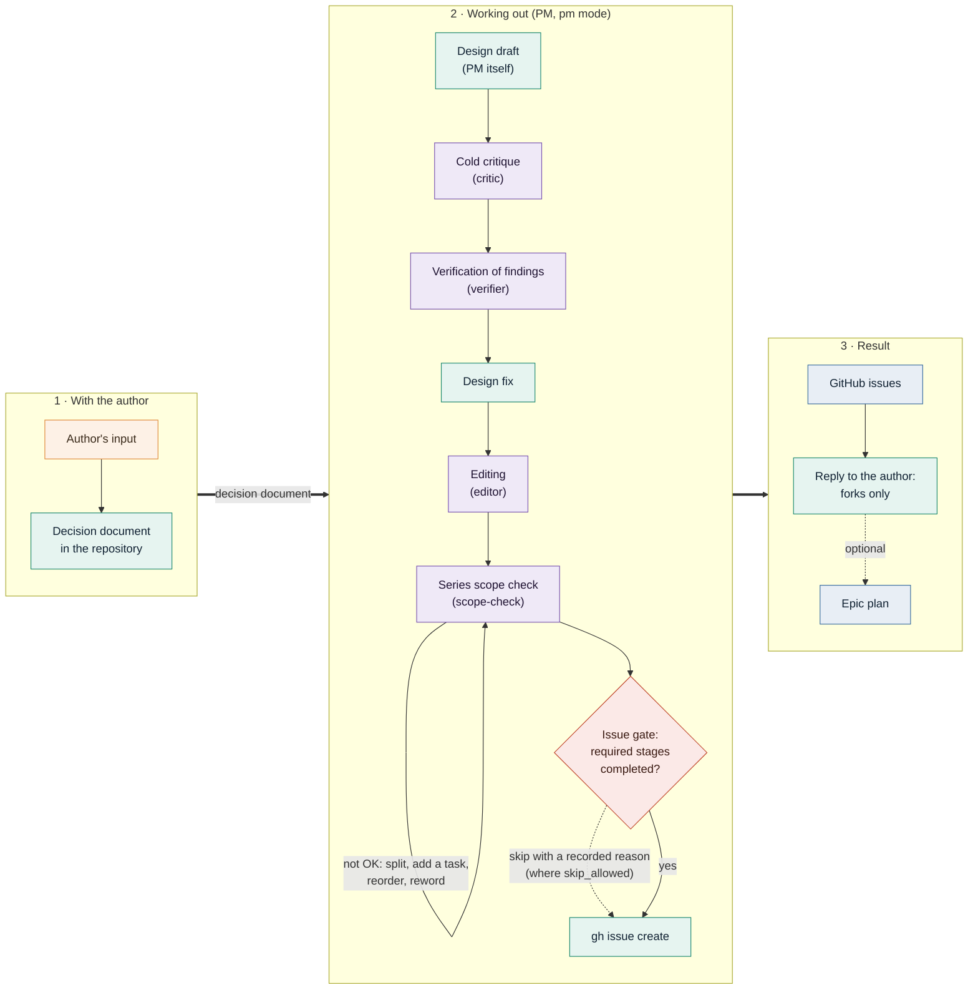
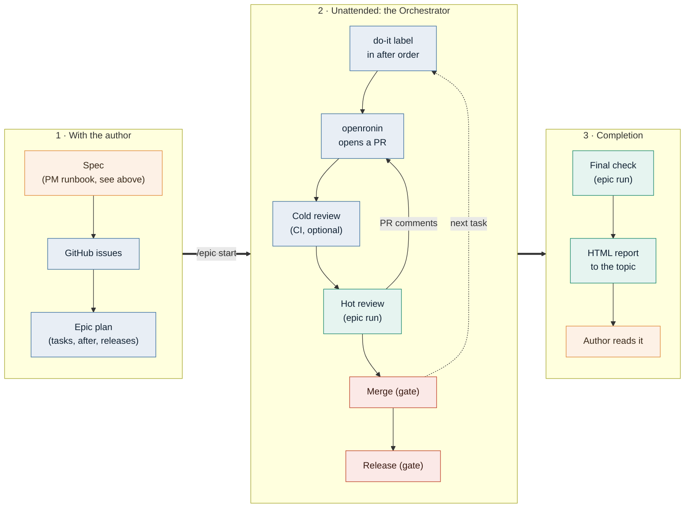
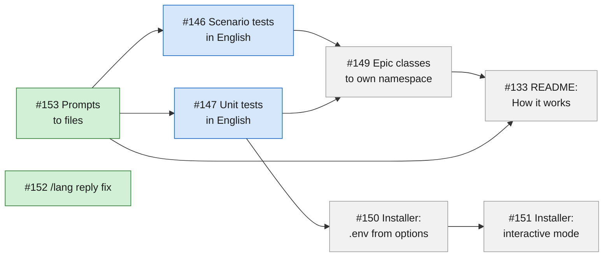

# Workspace Assistant

[](https://github.com/gpslab/workspace-assistant/actions/workflows/ci.yml)

<p align="center">
  
  <br>
  <em>An <a href="#epics">epic</a> from start to finish: design → issues → pull requests → review → merge → final check.</em>
</p>

A Telegram bot that turns chat messages into Claude Code
runs inside a git repository (the *workspace*, typically a knowledge base). You write to the bot from
your phone; the message goes to `claude -p` in the context of the workspace, the changes are committed
and pushed automatically, and the reply contains a link to the commit.

```
Telegram <-> bot (long polling) <-> claude -p --resume <session> <-> git push
```

<p align="center">
  
  <br>
  <em>Each forum topic is a separate Claude session; the bot is replying in <code>i18n</code> right now.</em>
</p>

> ## ⚠️ Security warning
>
> **By default the bot starts Claude with `--dangerously-skip-permissions`.** Claude then runs
> without any permission prompts and executes whatever a Telegram message asks it to: shell
> commands, file edits, network access, `git push` and `gh` calls. Everything runs **with the rights
> of the system user that runs the bot and with that user's `gh` token**.
>
> Anyone who gets into `ALLOWED_USER_IDS` (or takes over such a Telegram account), and anyone who can
> influence the text Claude reads (workspace files, issues, pull requests), can make the bot act as
> that user. Read [Security](#security) and isolate the process **before** you start the bot.

## Features

- Per-chat Claude sessions that continue between messages (`--resume`).
- Before each run: clean-tree check and `git pull --rebase`; after a successful run: commit and push.
- A request that arrives while the bot is busy is queued, not rejected.
- Live progress: the "Thinking..." message is updated with what Claude says and which tools it calls.
- Files in both directions: files sent to the bot are handed to Claude (inbox); files Claude puts
  into the outbox are sent back to the chat.
- Modes (`arch`, `review`, `pm`) with replaceable personas, interface locales, and *epics*: sets of
  GitHub tasks with dependencies that the bot's `Orchestrator` drives to completion — independent
  tasks run in parallel, dependent ones start once everything they depend on is merged.

## How it works

Besides chatting with a repository, the bot can carry work from an idea to a merged pull request. Claude
handles the steps that need judgement, the `Orchestrator` (the bot's own code) handles the
deterministic ones, an external executor ([openronin](https://github.com/openronin/openronin)) writes
the code, and the author keeps the decisions that must stay human.

```
architect (Claude, pm/arch mode) → [author: /epic start]
→ implementer (openronin) → cold review (CI, optional) → hot review (epic run)
→ merge (Orchestrator) → final check (epic run) → report [author]
```

- **Architect**: Claude in the `pm` or `arch` mode (default personas in `prompts/role_pm.md.dist` and
  `prompts/role_arch.md.dist`). It designs, pressure-tests the design, checks the findings against the
  facts, writes the task text with a list of load-bearing decisions, checks the scope and the order of
  the series, and opens the issues. The epic plan is a separate artefact: the file
  `<EPICS_DIR>/<slug>.md` that the author approves (see [EPICS.md](EPICS.md)).
- **Implementer**: openronin writes the code for an issue and opens a pull request. The integration
  with its labels and marker is built into the bot.
- **Cold review**: an optional CI reviewer that comments on the pull request. The hot review gives a
  verdict on each of its findings.
- **Hot review and final check**: epic runs of Claude that follow `prompts/epic_runbook.md.dist`. The
  hot review judges a pull request against the intent of the task and the epic plan and publishes
  the formal verdict; the final check verifies the whole epic and produces the report.
- **Merge and every other deterministic step**: the `Orchestrator`: labels, taking a pull request out
  of draft, merging, releases and the ceilings that stop a stuck epic.

The author decides three things: whether the tasks are right to run (re-read them, then send
`/epic start`), the forks the epic cannot resolve on its own, and, after reading the report, whether
to close the epic.

The design stage runs a pipeline of read-only sub-agents shipped with the bot (`critic`, `verifier`,
`editor`, `scope-check`, `acceptor`), and a gate refuses to create issues until the required stages ran:
see [Working out a task](#working-out-a-task). Any of them can be replaced by your own Claude Code
sub-agent with the same name, and the persona files and additions in `PROMPTS_DIR` change how the modes
and epic runs behave, see [Mode personas](#mode-personas). Details are in [Epics](#epics) and
[EPICS.md](EPICS.md).

## Requirements

- PHP 8.4+ with the extensions `curl`, `pdo_sqlite`, `pcntl` (and `posix`).
- Claude Code CLI, authenticated for the account you want to use.
- git with access to the workspace's remote (for example an SSH key).
- [GitHub CLI](https://cli.github.com/) (`gh`), authenticated with `gh auth login` as the user that
  runs the bot. Both Claude (issues, pull requests) and the bot itself (epic polling) call it.
- Composer, for development tooling only. The runtime has no Composer dependencies.

### Recommended

- [openronin](https://github.com/openronin/openronin) — the implementer that [epics](#epics) hand tasks to:
  it picks up issues labelled `openronin:do-it`, asks clarifying questions, opens pull requests and
  answers review comments. Epics rely on it; regular chat with the bot does not.
- [claude-memory-3layer](https://github.com/openronin/claude-memory-3layer) — in-repo memory for Claude
  Code. Installed for the managed repository, it gives every run the project's conventions and known
  pitfalls (`CLAUDE.md` plus on-demand docs) and keeps working state across `/compact` and new sessions.
  The bot does not require it.

## Installation

```bash
git clone https://github.com/gpslab/workspace-assistant.git
cd workspace-assistant
php bin/install.php --bot-token-file=/path/to/token-file --allowed-user-ids=1001 --repo-path=/path/to/repo
php bin/bot.php
```

1. Create a bot with [@BotFather](https://t.me/BotFather) and keep the token.
2. Find your Telegram user id with [@userinfobot](https://t.me/userinfobot).
3. Clone the workspace repository, make sure `git pull` and `git push` work there without prompts,
   and note its absolute path.

The list of changes between versions is on the
[GitHub Releases](https://github.com/gpslab/workspace-assistant/releases) page; read it before updating.

### Installer (`bin/install.php`)

`bin/install.php` writes `.env`, checks the environment and the network and prints a systemd unit and a cron
line. It installs no packages, does not log in to `claude` or `gh`, does not touch `/etc` or `systemctl`
and does not start the bot. The output is in English.

- **Modes.** With `--non-interactive`, or when stdin is not a terminal, nothing is asked: values come from the
  options and the existing `.env`. Otherwise the installer is interactive: it asks for every key (except
  `STATE_DIR`) with the current value as the default (an empty answer keeps it) and repeats a question on an
  invalid answer. `CLAUDE_EXTRA_ARGS` is a separate question preceded by the security warning. The bot token
  is typed without echo; the terminal echo is restored even on Ctrl+C.

| Option                      | Key                                                                |
|-----------------------------|--------------------------------------------------------------------|
| `--bot-token`               | `BOT_TOKEN` (required)                                             |
| `--bot-token-file=PATH`     | read `BOT_TOKEN` from a file (a trailing line break is trimmed)    |
| `--allowed-user-ids`        | `ALLOWED_USER_IDS` (required; digits separated by commas)          |
| `--repo-path`               | `REPO_PATH` (required)                                             |
| `--github-owners`, `--github-repo`, `--claude-bin`, `--bot-locale`, `--timezone`, `--openronin-logins`, `--claude-extra-args` | the key of the same name (optional) |
| `--non-interactive`         | never ask questions (implied when stdin is not a terminal)         |
| `--skip-network-checks`     | report a failed `getMe` / `git ls-remote` as a warning, not an error |
| `--unit-file=PATH`          | also write the systemd unit to `PATH` (the directory must exist)   |
| `--allow-root`              | allow running as root (refused by default)                         |

- `BOT_TOKEN` sources: `--bot-token-file`, `--bot-token` or the `BOT_TOKEN` environment variable.
  Passing more than one source is an error (a stale exported `BOT_TOKEN` would override `.env`). The file or the environment keeps the token out of `ps` and the shell history.
- Values not passed are taken from the existing `.env`; without one, `.env.dist` is the base. The example
  values of `.env.dist` (`PASTE_YOUR_BOT_TOKEN_HERE`, `123456789`, `/path/to/your/repo`) count as unset.
- Values are written unquoted. A value with a line break, `#`, leading/trailing whitespace, wrapping quotes or
  a trailing `=` is rejected, because `src/Env.php` and the bash parser (`bin/env.sh`) would read it differently.
  The last occurrence of a key is replaced and earlier duplicates are removed; a commented `# KEY=value`
  is uncommented in place; unknown keys and comments are kept; new keys are appended.
- All errors are listed at once and `.env` is left untouched. The file is written to `.env.tmp-<pid>`, checked
  by building the bot configuration from it (this also creates the state, `inbox` and `outbox` directories),
  the previous `.env` is copied to `.env.bak` (one backup, overwritten on every run) and the new file is
  renamed over `.env`. Files get mode 0600.
- With `--dangerously-skip-permissions` in `CLAUDE_EXTRA_ARGS` (the default) the installer always warns on
  stderr and in the summary; see [Security](#security).
- The installer refuses to run as root unless `--allow-root` is given; files it creates then belong to root,
  so `chown` them to the bot's user if that is a different one.
- `REPO_PATH` must be an absolute path to a git repository.
- Checks run before anything is written. An error exits non-zero and leaves `.env` untouched; a warning goes
  to stderr and the summary and the write continues. Every external call has a timeout.

  | Check                                                                   | On failure                                      |
  |-------------------------------------------------------------------------|-------------------------------------------------|
  | PHP version from `composer.json`; extensions `curl`, `pdo_sqlite`, `pcntl`, `posix` | error                           |
  | `git`, `gh` and the `CLAUDE_BIN` binary run (`--version`)               | error                                           |
  | `BOT_LOCALE` is in the catalog; `TIMEZONE` is valid; `REPO_PATH` is a git repository | error                      |
  | Bot API `getMe` accepts the token                                       | error (warning with `--skip-network-checks`)    |
  | `git -C REPO_PATH ls-remote` works without prompts                      | error (warning with `--skip-network-checks`)    |
  | `gh auth status`                                                        | warning (only epics need `gh`)                  |

  `git` runs with `GIT_TERMINAL_PROMPT=0`, `BatchMode=yes` and `StrictHostKeyChecking=yes` (the bot itself
  uses `accept-new`), so on a fresh server an unknown host key fails the check with an `ssh-keyscan` hint:
  verify the fingerprint and add the key to `~/.ssh/known_hosts`.
- The systemd unit from [Running as a service](#running-as-a-service) (`User` is the current user,
  `WorkingDirectory` the installation directory, `ExecStart` the running PHP binary and `bin/bot.php`) and the
  cron line from [Monitoring `gh` authentication](#monitoring-gh-authentication) are printed. The unit is
  written to a file only with `--unit-file=PATH`; installing it is up to you.
- When `.env` already existed, restart a running bot (`bin/ctl.sh restart` or your service manager) to apply the changes.

Configuration lives in `.env` (`KEY=VALUE`, edit it by hand or re-run the installer); lists are comma-separated. Real environment variables
override the file. Every setting is documented in [`.env.dist`](.env.dist).

### Running as a service

`bin/ctl.sh` manages a background process (`start`, `stop`, `restart`, `status`, `fg`, `logs`); the PID
file and the log go to `STATE_DIR` (from the environment or `.env`, default `./state`; a relative path is
taken from the installation directory), the same directory the bot uses. Use `PHP_BIN=/path/to/php bin/ctl.sh start` to choose the PHP binary.

Alternatively, a systemd unit (use the dedicated user from the [isolation recipe](#isolation-recipe)):

```ini
[Unit]
Description=Workspace Assistant bot
After=network.target

[Service]
WorkingDirectory=/opt/workspace-assistant
ExecStart=/usr/bin/php /opt/workspace-assistant/bin/bot.php
Restart=always
User=workspace-assistant

[Install]
WantedBy=multi-user.target
```

The bot handles `SIGTERM`: it finishes the current loop iteration, kills the running Claude child
process and exits. Only **one instance per bot token** may run, otherwise Telegram answers with 409.

### Monitoring `gh` authentication

`bin/check_gh_auth.sh` checks `gh auth status` and, if the authorization has expired, sends a message
to every id in `ALLOWED_USER_IDS` through the Bot API. It reads `BOT_TOKEN` and `ALLOWED_USER_IDS`
from the `.env` next to it and stays silent when everything is fine. Run it from cron, for example weekly:

```cron
0 9 * * 1 /opt/workspace-assistant/bin/check_gh_auth.sh >> /opt/workspace-assistant/state/check_gh_auth.log 2>&1
```

## Configuration

| Variable | Default | Meaning |
|----------|---------|---------|
| `BOT_TOKEN` | required | Bot token from @BotFather |
| `ALLOWED_USER_IDS` | required | Whitelist of Telegram user ids |
| `REPO_PATH` | required | Absolute path to the workspace git repository |
| `GITHUB_REPO` | empty | Workspace repository as `owner/name`, for commit links |
| `GITHUB_OWNERS` | empty | GitHub owners the bot works with; the first is the default owner |
| `OPENRONIN_LOGINS` | empty | Logins allowed to author the `<!-- openronin:bot -->` marker |
| `CLAUDE_BIN` | `claude` | Path or name of the `claude` binary |
| `CLAUDE_TIMEOUT` | `0` | Overall limit of one Claude call, seconds (0 = off) |
| `CLAUDE_STALL_TIMEOUT` | `900` | Kill Claude after this many silent seconds (0 = off) |
| `CLAUDE_EXTRA_ARGS` | `--dangerously-skip-permissions` | Extra `claude` arguments, comma-separated |
| `CLAUDE_APPEND_SYSTEM_PROMPT` | empty | Text appended to the system prompt |
| `PROMPTS_DIR` | empty | Persona files, relative to `REPO_PATH`; the texts in `prompts/` apply without it |
| `STATE_DIR` | `./state` | State directory (SQLite, inbox, outbox, epic signals) |
| `POLL_TIMEOUT` | `30` | Long-polling timeout, seconds |
| `GIT_TIMEOUT` | `120` | Timeout of `git pull`/`push`, seconds |
| `SUBREPOS_DIR` | empty | Directory of git clones inside `REPO_PATH` that are pulled before a run |
| `TIMEZONE` | `UTC` | PHP timezone identifier for logs and dates |
| `BOT_LOCALE` | `en` | Interface locale |
| `LOCALES_DIR` | empty | Own locale files, relative to `REPO_PATH` |
| `EPICS_DIR` | `.workspace-assistant/epics` | Epic plans and journals, relative to `REPO_PATH` |
| `EPIC_POLL_SECONDS` | `30` | Seconds between epic poll passes, counted from the end of the previous pass (minimum `10`) |
| `EPIC_TICK_MINUTES` | `30` | Interval of the timer tick |
| `EPIC_STALL_TICKS` | `6` | Timer ticks in a row without progress before the epic is blocked |
| `EPIC_QUIET_MINUTES` | `10` | PR quiet period before the hot review; a safety net, since the review is queued earlier once openronin has the last word on a green PR |
| `EPIC_ANSWER_TIMEOUT_MINUTES` | `120` | Timeout of `openronin:awaiting-answer` |
| `EPIC_MASTER_RED_HOURS` | `6` | Hours a confirmed red default branch is tolerated |

### Sub-repositories and time zone

`SUBREPOS_DIR` is a directory of git clones inside `REPO_PATH`. When set, before each run the bot does
`git pull --rebase` in every clone there, snapshots their HEAD and adds links to their new commits to
the reply. `TIMEZONE` is used for `date()` and log lines; an unknown value fails the startup.

### Interface language

Bot texts, command descriptions, the epic status card and notices, and the comments and commit messages
the bot composes come from locale files `resources/locales/<code>.json` (built in: `de`, `en`, `es`, `fr`, `hi`, `ja`, `kk`, `ko`, `pt`, `ru`, `uk`, `uz`, `zh`).
`BOT_LOCALE` selects the locale; a code without a file falls back to `en` with a warning in the log.
Prompts sent to Claude, log lines and exceptions are not localized.

A locale file is a flat `"key": "text"` object plus three service fields:

- `_language`: the English name of the language;
- `_flag`: the flag emoji on the `/lang` button;
- `_native`: the self-name of the language on the `/lang` button.

Placeholders are named: `{name}`. The service fields are not interface texts, so they are not
checked against `en.json` for keys and placeholders.

`_flag` and `_native` come only from the catalog of the locale itself and never fall back to `en`.
An instance file in `LOCALES_DIR` overrides the built-in file of the same locale key by key:

- a field missing in the instance file keeps the built-in value of the same locale, if the locale has a
  built-in file;
- an empty string means "no flag" for `_flag`, and for `_native` it falls back to `_language`, then to
  the locale code.

To add a language, add a file with all interface keys of `en.json` and the same placeholders, and set
the three service fields for the new language, not copied from `en.json`: copied fields show the
language on `/lang` as "🇬🇧 English", with no warning. This applies both to an operator's locale in
`LOCALES_DIR` and to a built-in locale added through a PR. `LOCALES_DIR` is an optional directory of
your own locales: its files add to and override the built-in ones key by key.

### Mode personas

The system prompt of each mode (`arch`, `review`, `pm`) is a *contract* plus a *persona*. The contract
(delivery rules, response-size limit, the review verdict rules the bot parses) and the persona both ship
as `prompts/<name>.md.dist` files. Like `.env.dist` / `.env`, a local `prompts/<name>.md` (gitignored)
overrides the `.dist` of the same name; if it is absent, the `.dist` is used. The persona has one more
layer on top: files in `PROMPTS_DIR`, `common.md` (shared) and `arch.md`, `review.md`, `pm.md` (the role
block of a mode). Layers, first found wins:

- common block: `PROMPTS_DIR/common.md` → `prompts/persona_common.md` → `prompts/persona_common.md.dist`;
- role block: `PROMPTS_DIR/<mode>.md` → `prompts/role_<mode>.md` → `prompts/role_<mode>.md.dist`.

`epic.md` in `PROMPTS_DIR` is an optional addition to the epic runbook (`prompts/epic_runbook.md.dist`),
used in epic runs only. `pm_runbook.md` in `PROMPTS_DIR` is an addition to the PM runbook
(`prompts/pm_runbook.md.dist`), see [Working out a task](#working-out-a-task). Files are re-read on every run; an edit applies from the next run. A prompt file
that is empty or unreadable is ignored in favour of the next layer, with a warning in the reply.

Overriding a contract text (`common`, `common_limits`, `contract_review`, `language_line`,
`session_update`, `review_status_reason*`, `compact_*`, `epic_runbook`, `pm_runbook`) is possible but never silent: every run adds a
warning with the file name to the reply. Keep the `{name}` placeholders of the `.dist` in your override.
After an update, diff your overrides against `.dist`.

Persona files live in the managed repository, so a run can edit them and the auto-commit publishes the
edit without review. When a run changes files under `PROMPTS_DIR`, the reply carries a warning listing them.

## Commands

| Command | Action |
|---------|--------|
| _text_ | Send a request to Claude in the context of the repository |
| `/new` | Start a new session (reset the context) |
| `/compact` | Compress the session into a summary instead of a full reset |
| `/cancel` | Abort the topic's process and drop its queued requests |
| `/queue` | Show the request queue |
| `/stats` | Session statistics (tokens, messages) |
| `/verbose` | Show token usage in every reply |
| `/mode` | Switch the mode: `arch`, `review` or `pm` |
| `/lang` | Language of Claude's replies in the chat |
| `/epic` | Epics: `start <slug>`, `pause`, `resume`, `status`; without an argument — buttons for the actions that apply to the topic's epic now (start goes through a plan list and a confirmation) |
| `/restart` | Restart the bot to pick up new code |
| `/help` | Help |

### Request queue

The bot runs at most one Claude process at a time in the working tree. Requests that arrive meanwhile
go into a single FIFO queue stored in SQLite, keyed by `(chat_id, thread_id)`, so private chats and
forum topics are independent. Consecutive pending messages of one topic in the same mode are merged
into one request. The queue pauses when the working tree is dirty (commit/discard buttons appear) and
when Claude reports a usage limit.

One run at a time is a supported property, not a temporary limitation, and it covers the bot's own
Claude runs of every kind: chat requests and the isolated runs of epics alike. The managed repository
has a single working tree, and a dirty tree has a single pending commit/discard decision. This does not
contradict "independent tasks run in parallel" in epics: there the parallel work is done by the
implementer (openronin), not by the bot's Claude runs.

### Files

- **Outbox.** Files Claude puts into `<STATE_DIR>/outbox` during a run are sent to the chat before the
  text reply (images as photos, the rest as documents; Bot API limits apply, at most 10 files per run),
  then the directory is cleared.
- **Inbox.** Any file sent to the bot (photo, document, audio, video, voice, ...) is downloaded to
  `<STATE_DIR>/inbox` and passed to Claude by path; the caption becomes the request text. Albums are
  combined into one request. Files are deleted after the run.

<p align="center">
  
  <br>
  <em>Files Claude puts into the outbox arrive in the chat: here a diagram and its Mermaid source.</em>
</p>

## Working out a task

Before an epic exists, the author and Claude in the `pm` mode work out the task. The bot does not run
the stages itself: in the `pm` mode it prepends a line to the message, "if this message starts or
continues working out a task, follow the PM runbook: read `<path>`", and Claude follows
`prompts/pm_runbook.md.dist` (or a local `prompts/pm_runbook.md`) inside its session. Epic runs get the
same line and follow the variant without an author: the stages that involve the author do not apply.



The set of stages comes from the pipeline config of the runbook (see below); an instance can change it.
The diagram shows the default config.

### Stages

1. **Author's input**: written word for word into the decision document in the repository.
2. **Design draft**: written by the PM itself, never delegated.
3. **Cold critique** (`critic`): an agent without the session's context attacks the draft.
4. **Verification** (`verifier`): every finding is checked against the facts (code, command output).
5. **Design fix**: for every confirmed finding; the analysis goes into the decision document.
6. **Editing** (`editor`): tightens the text without changing the listed load-bearing decisions.
7. **Series scope check** (`scope-check`): every pull request stays in scope, passes the CI gates of its
   repository, and the series has every prerequisite in the right order. Problems are fixed (split, add
   the missing task, reorder, reword) before any issue is opened.
8. **Issues**: opened from the checked task texts.
9. **Reply to the author**: only forks, each with an option, its consequence and a recommendation.

Agents are called synchronously (`run_in_background: false`).

### Built-in agents

The bot hands five read-only sub-agents to every Claude run (except the two phases of `/compact`) with
`--agents <file>`: `critic`, `verifier`, `editor`, `scope-check` and `acceptor`. Their bodies are
`prompts/agents/<name>.md.dist`. To override one:

- an agent with the same `name:` (the frontmatter value, not the file name) in `.claude/agents/*.md` of
  the managed repository or in `~/.claude/agents/*.md` of the bot's user wins: the bot does not pass the
  built-in agent of that name;
- if `CLAUDE_EXTRA_ARGS` already contains `--agents`, no built-in agents are passed and the reply carries
  a warning;
- to change only the body, put a local `prompts/agents/<name>.md` next to the `.dist` (the
  [`PromptFiles`](#mode-personas) mechanism). It replaces the whole file and must keep `name:`.

### Pipeline config

The first fenced `json` block of the runbook is the pipeline config:

```json
{
  "stages": [
    {"id": "critique", "agent": "critic", "required": true},
    {"id": "verify", "agent": "verifier", "required": true},
    {"id": "edit", "agent": "editor", "required": true},
    {"id": "scope", "agent": "scope-check", "required": true}
  ],
  "skip_allowed": {"pm": false, "review": true, "tick": false, "final": false, "epic_review": true}
}
```

- `stages`: the stages that call an agent, in order; each has an `id`, an `agent` and `required`.
- `skip_allowed`: per kind of run (`pm`, `review`, `tick`, `final`, `epic_review`) whether a required
  stage may be skipped. By default only `review` and `epic_review` allow it (side findings of a review).

The config is taken from `prompts/pm_runbook.md.dist`. A local `prompts/pm_runbook.md` replaces it as a
whole (a contract text: every run warns about the substitution). `PROMPTS_DIR/pm_runbook.md` is an
*addition*, like `epic.md`: its text is appended to the runbook, and its first `json` block, if any,
replaces `stages` entirely and overrides `skip_allowed` per kind of run. An invalid local
`prompts/pm_runbook.md` falls back to the `.dist` config; an invalid addition is dropped and the config
without it is used. The warning goes into the reply in the `pm` mode and into the log otherwise.

### The issue-creation gate

A `PreToolUse` hook on `Bash` in the `pm` and `review` modes (and in epic runs) refuses to create an issue
until the required stages ran. The `arch` mode is not covered.

- It catches `gh issue create` and `gh api repos/X/Y/issues` that creates an issue; comments
  (`.../issues/N/comments`) pass.
- A stage counts as done when the main chain of the transcript holds an `Agent` call with that
  `subagent_type` and `toolUseResult.status == "completed"`. Background calls do not count.
- Window: stage calls after the last successful issue creation that was followed by a message of the
  author. A series of issues created in one batch passes on one set of stages; the next design is
  checked again.
- Order: the last call of a stage is not earlier than the last call of the previous required stage.
- The config is a snapshot taken when the run starts; editing it inside the run does not affect the gate.
- Skipping: where `skip_allowed` is true for the kind of run, Claude writes the reason into the file named
  by the `WORKSPACE_ASSISTANT_PM_SKIP` environment variable and repeats the command; the bot shows the skip
  in the reply (or the log).
- The hook is fail-closed: if it fails, the command is blocked. Every deny is written to
  `<STATE_DIR>/pm-gate.log`.

Limits, stated plainly:

- The gate checks the process, not the verdict: that the stage agents were called, not that their
  findings were taken into account.
- Creating an issue with `curl` or GraphQL is not caught.
- The `arch` mode is not closed by the gate.

### Why write your own `scope-check`

The built-in `scope-check` is generic: CI gates of the target repository, one pull request one scope,
prerequisites and the order of the series. It cannot know the rules specific to your repository, and they
cannot be derived from the task text. Example: in a monorepo, a new package must first be added to an
allowlist by a separate task that is merged first. Without a step that knows this, the pull request fails
CI or goes out of scope. Plug in your own agent under the same `name:` in `.claude/agents/`, or assign
another agent to the `scope` slot in the pipeline config.

## Epics

An epic is an author-approved set of GitHub tasks with an execution order. The bot stores the epic,
parses its plan and queues isolated Claude runs; the `Orchestrator` decides when a run is needed and
performs the deterministic steps (labels, merges, releases) itself, while judgement calls (review,
answers, follow-up tasks, forks, the final report) are made by Claude following
`prompts/epic_runbook.md.dist` (or a local `prompts/epic_runbook.md`).

### How an epic runs

From design with the author to the final report, the epic goes through three stages:



How the task text and the issues of stage 1 are produced is shown in [Working out a task](#working-out-a-task).

### The plan is a dependency graph

- **Parallel by default.** Every task whose dependencies are met is handed over in the same pass, so
  independent tasks are implemented, reviewed and merged side by side (in the card below one task is
  in review while another one's CI is running).
- **Dependencies are enforced.** A task with `after` is not started until every task it depends on is
  merged, also across repositories (`frontend#3` after `backend#12`); a contract release waits for its
  `after` tasks the same way. A cycle in the plan is rejected at `/epic start`.
- **Problems stay local.** A red `master` pauses merges and releases of that repository only, and
  `hold` parks a single task; the rest of the epic keeps going.

<p align="center">
  
  <br>
  <em>The epic card is one message the bot keeps up to date: each task's state, what it waits for, and the last journal entry.</em>
</p>

The plan of that epic, as a graph (states as in the screenshot). #152 depends on nothing and was merged
alongside #153; #146 and #147 started together as soon as #153 was merged; #149 waits for both of them,
while the installer branch (#150 → #151) only needs #147:



Green — merged, blue — in progress (review, CI), grey — waiting for dependencies.

Before the bot merges a pull request of an epic, it goes through the hot review with the epic's context; if a
cold CI reviewer is set up, its findings come first and the hot review gives each of them a verdict. openronin
answers the findings and pushes fixes:

<p align="center">
  
  <br>
  <em>Cold review recommendation → openronin's fix → hot review with the epic's context.</em>
</p>

### Plan format

The plan is the first fenced `json` block of `<EPICS_DIR>/<slug>.md` inside `REPO_PATH`:

```json
{
  "tasks": [
    {"task": "backend#12"},
    {"task": "frontend#3", "after": ["backend#12"]}
  ],
  "releases": [
    {"repo": "backend", "version": "v1.2.0", "after": ["backend#12"]}
  ]
}
```

`task` is `owner/repo#N` or `repo#N` (the default owner is the first of `GITHUB_OWNERS`); `after` lists
dependencies from the same plan. The journal `<EPICS_DIR>/<slug>.journal.md` is the epic's memory
between runs. Epic statuses: `running`, `paused`, `blocked`, `done`. Each epic topic gets one status card
message that the bot keeps up to date.

Epics rely on `gh`, on `GITHUB_OWNERS`, and on the marker comments they publish: the epic marker counts
only when it comes from the `gh` account the bot runs as, and the `<!-- openronin:bot -->` marker counts
only from the logins in `OPENRONIN_LOGINS` (set it, otherwise any author is accepted). Merges happen only
after an approving review, green checks and no unreviewed changes since the approval.

The full reference — `/epic` semantics, the status card, run input and signal, cold reviewer findings,
the orchestrator's detector and ticks, the merge/release gates and ceilings, and stop/failure handling —
is in [EPICS.md](EPICS.md).

## Why polling, not webhooks

The bot polls both Telegram and GitHub; there is no inbound port.

**Telegram**

- Long polling is already immediate: Telegram answers the open `getUpdates` request as soon as an
  update arrives. `POLL_TIMEOUT` is how long to wait when nothing comes, not a delivery delay.
- Telegram keeps unconfirmed updates (up to 24 hours) and the offset confirms them, so the bot needs
  no inbound queue of its own. A webhook needs an always-responsive HTTP receiver next to the
  single-threaded loop and a hand-over from it to the loop — re-implementing what `getUpdates`
  already provides.
- `getUpdates` and a webhook are mutually exclusive: switching is all or nothing.
- Long polling needs no inbound port, public HTTPS endpoint or reverse proxy; the bot runs anywhere
  with outbound network access.

**GitHub**

- Claude runs are asynchronous, but the loop is blocked synchronously by the GitHub poll pass (tens
  of seconds) and network git operations (usually seconds, up to `GIT_TIMEOUT`). GitHub waits 10 s
  for a delivery answer and does not redeliver failed deliveries automatically, so a listener inside
  the loop would lose deliveries. A separate listener process is an inbound network surface running
  as the bot's user, plus a reverse proxy and a hook on every repository.
- A webhook could not replace polling: timer transitions (quiet period before the hot review, timer
  tick, answer timeout, red default branch) happen without any GitHub event, so the poll stays the
  source of truth and its interval stays short anyway.
- The gain would be tens of seconds per event; a short `EPIC_POLL_SECONDS` while an epic is running
  gives the same order of latency without a new surface.
- Latency is of the order of `EPIC_POLL_SECONDS` plus the pass duration; with several epics a pass
  can be cut by its 20 s budget and the next epic waits for the following pass.
- Cost, per pass: GraphQL — one query per epic task (1 point each) and one default-branch CI query
  per repository; REST — one Actions-runs call per task that has a PR, plus one or two compare calls per
  approved open PR (five more per master-merge commit since the approval). GraphQL points and REST requests have separate hourly limits (5000 each for a user
  token), both shared with `gh` calls made inside runs. Example: a 15-task epic at 30 s ≈ 2000
  GraphQL points and ≈ 1800 REST requests per hour, plus ~240 per approved PR still open; fewer in
  practice, since the interval counts from the end of a pass. While a pass runs the bot does not read
  Telegram or the active run's output (nothing is lost, it is delayed). Raise `EPIC_POLL_SECONDS`
  for large epics or a busy account.

## Security

The bot is built for a **trusted workspace and a trusted, short whitelist of users**. Treat it like a
remote shell for everyone in `ALLOWED_USER_IDS`.

- The whitelist `ALLOWED_USER_IDS` is the only authentication; protect those Telegram accounts.
- Arguments to the CLI and git are passed as arrays through `proc_open`, so there is no shell injection.
- `.env` and `state/` are in `.gitignore`.
- **`--dangerously-skip-permissions` is the default** of `CLAUDE_EXTRA_ARGS`. Claude can run any command
  as the bot's system user and use that user's `gh` token and git credentials. Content Claude reads
  (files, issues, PR text) can steer it too (prompt injection).
- Changes are committed and pushed automatically, including edits to persona and locale files.

To report a vulnerability privately, see [SECURITY.md](SECURITY.md).

### Isolation recipe

1. **Dedicated user without sudo.** Run the bot as its own account that is not in `sudo`/`wheel` and owns
   nothing but the bot, the workspace and the state directory:

   ```bash
   sudo useradd --system --create-home --shell /bin/bash workspace-assistant
   sudo -u workspace-assistant -i   # install the bot, Claude CLI, clone the workspace here
   ```

   Keep SSH keys and credentials of other services out of its home directory.
2. **Narrow `gh` token.** Authenticate `gh` as that user with a fine-grained personal access token (or a
   machine account) limited to the repositories the bot needs and to the minimum permissions: contents
   and pull requests read/write, issues read/write, and nothing about administration, secrets or workflows.
   Use a deploy key or a similarly scoped credential for git.
3. **Contain the process.** Prefer a VM or container, or systemd hardening (`ProtectSystem=strict`,
   `ReadWritePaths=` for the workspace and state, `NoNewPrivileges=true`, `PrivateTmp=true`), and restrict
   outbound network access where possible.
4. **Disable the flag if you can.** Set `CLAUDE_EXTRA_ARGS` to something stricter, for example
   `CLAUDE_EXTRA_ARGS=--permission-mode,acceptEdits` (or an empty value for no extra arguments). Note that in
   non-interactive `-p` mode Claude cannot answer permission prompts, so tools that need approval
   will simply be refused.
5. **Keep the whitelist minimal** and review the commits the bot pushes.

## Development

```bash
composer install      # dev tooling: php-cs-fixer, phpstan, phpunit
composer cs           # fix the code style (@Symfony)
composer cs:check     # check the style without changes
composer stan         # static analysis (phpstan level 8)
composer test         # unit tests (phpunit)
composer test:coverage  # unit tests with a coverage summary and coverage.xml
```

`composer test:coverage` needs a coverage driver enabled in `php.ini` (`pcov.enabled=1`, or Xdebug with
`XDEBUG_MODE=coverage`): `php -d …` passed to `composer` does not reach the PHPUnit process. Where pcov is
installed but disabled, run `php -d pcov.enabled=1 vendor/bin/phpunit --coverage-text --coverage-clover=coverage.xml`.

CI runs `cs:check`, `stan` and `test` on PHP 8.4 and 8.5 on every push to `master` and on every pull
request; the 8.5 job runs the tests with coverage and prints the summary.

## License

Released under the [MIT License](LICENSE).

Third-party interfaces, marks and content (including chat avatars) shown in the screenshots in `assets/` belong to their respective owners and are not covered by the MIT License. `assets/hero.jpg` was generated with Midjourney and is not covered by the MIT License. Claude is a trademark of Anthropic, PBC; Telegram, GitHub and other names mentioned are trademarks of their respective owners. This project is not affiliated with or endorsed by them.
