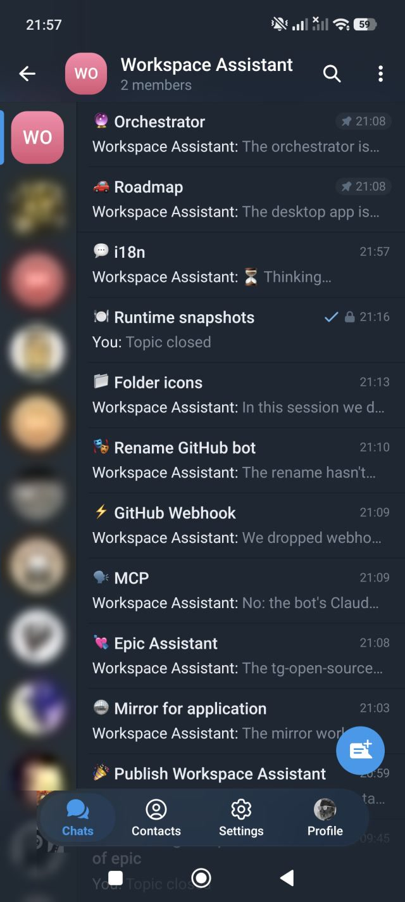
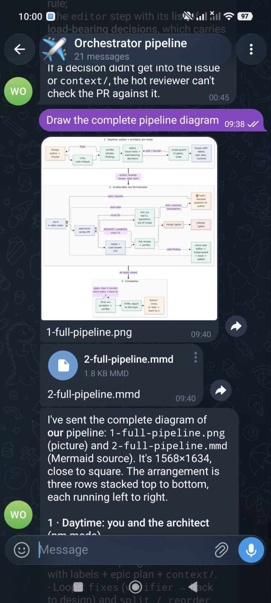

# Workspace Assistant

[](https://github.com/gpslab/workspace-assistant/actions/workflows/ci.yml)

<p align="center">
  
  <br>
  <em>An <a href="EPICS.md">epic</a> from start to finish: design → issues → pull requests → review → merge → final check.</em>
</p>

A Telegram bot that turns chat messages into Claude Code
runs inside a git repository, the *managed repository*. It is meant to be a knowledge base: a repository
of documents that you edit through chat, not a code base. You write to the bot from your phone; the
message goes to `claude -p` in the context of the managed repository, the changes are committed and
pushed automatically (unless `AUTO_COMMIT=0`), and the reply contains a link to the commit. See
[How it works](#how-it-works) for what exactly is committed and pushed.

```
Telegram <-> bot (long polling) <-> claude -p --resume <session> <-> git push
```

<p align="center">
  
  <br>
  <em>Each forum topic is a separate Claude session; the bot is replying in <code>i18n</code> right now.</em>
</p>

> ## ⚠️ Security warning
>
> **By default the bot starts Claude with `--dangerously-skip-permissions`.** Claude then runs
> without any permission prompts and executes whatever a Telegram message asks it to: shell
> commands, file edits, network access, `git push` and `gh` calls. Everything runs **with the rights
> of the system user that runs the bot and with that user's `gh` token**.
>
> Anyone who gets into `ALLOWED_USER_IDS` (or takes over such a Telegram account), and anyone who can
> influence the text Claude reads (managed repository files, issues, pull requests), can make the bot act as
> that user. Read [Security](#security) and isolate the process **before** you start the bot.

## Features

- Per-chat Claude sessions that continue between messages (`--resume`).
- Before each run: clean-tree check and `git pull --rebase`; after a successful run: commit and push of the managed repository. With `AUTO_COMMIT=0` the bot does none of this in the managed repository.
- A request that arrives while the bot is busy is queued, not rejected.
- Live progress: the "Thinking..." message is updated with what Claude says and which tools it calls.
- Files in both directions: files sent to the bot are handed to Claude (inbox); files Claude puts
  into the outbox are sent back to the chat.
- Modes (`arch`, `review`, `pm`) with replaceable personas, interface locales, and *epics*: sets of
  GitHub tasks with dependencies that the bot's `Orchestrator` drives to completion — independent
  tasks run in parallel, dependent ones start once everything they depend on is merged.

## How it works

### The managed repository: commit and push

The managed repository is a **knowledge base**: a repository of documents that you edit through chat,
not the code base of a project. After every successful run that changed files the bot commits all
changes (`git add -A`) with the message `tg: <first line of the request, up to 60 chars>` (epic runs:
`tg: epic <slug>`) and pushes the current branch with a plain `git push`. A run that changed nothing
produces no commit and no push. Changes left by an interrupted run, a failed regular request, or by
someone else are not committed automatically: the bot asks whether to commit or discard them. A failed
epic run asks nothing: its changes are saved as `dirty-<timestamp>.patch` next to `failures.log` in
`<STATE_DIR>/epics/<slug>/`, and the tree is rolled back. Nothing else is reviewed before a push, so do
not point the bot at a code project.

With `AUTO_COMMIT=0` the bot neither commits, pushes nor pulls the managed repository: there is no
clean-tree check, no commit/discard buttons and no commit link for the managed repository (links to
sub-repository commits can still appear), and the changes of every run stay in
the working tree for you to commit. All topics share one working tree, so the changes of one topic are
visible in the next run of another. Sub-repositories under `SUBREPOS_DIR` are still pulled.

- If the push fails, the reply reports the error and has no link to the managed repository commit
  (links to sub-repository commits can still be there). The commit stays local and goes out with the
  next run that changes files, or push it by hand. On a protected branch every push fails, so local
  commits pile up.
- Code lives in separate repositories, and changes there go through pull requests:
  - sub-repositories under `SUBREPOS_DIR`: the bot pulls them before a run and links their new commits
    in the reply. Whether they are committed and pushed is up to Claude, following the managed
    repository's own instructions. The bot does not commit them.
  - epics: their tasks are implemented as pull requests.

### Epics and the pipeline

Besides chatting with a repository, the bot can carry work from an idea to a merged pull request. Claude
handles the steps that need judgement, the `Orchestrator` (the bot's own code) handles the
deterministic ones, an external executor ([openronin](https://github.com/openronin/openronin)) writes
the code, and the author keeps the decisions that must stay human.

```
architect (Claude, pm/arch mode) → [author: /epic start]
→ implementer (openronin) → cold review (CI, optional) → hot review (epic run)
→ merge (Orchestrator) → final check (epic run) → report [author]
```

- **Architect**: Claude in the `pm` or `arch` mode (default personas in `prompts/role_pm.md.dist` and
  `prompts/role_arch.md.dist`). It designs, pressure-tests the design, checks the findings against the
  facts, writes the task text with a list of load-bearing decisions, checks the scope and the order of
  the series, and opens the issues. The epic plan is a separate artefact: the file
  `<EPICS_DIR>/<slug>.md` that the author approves (see [EPICS.md](EPICS.md)).
- **Implementer**: openronin writes the code for an issue and opens a pull request. The integration
  with its labels and marker is built into the bot.
- **Cold review**: an optional CI reviewer that comments on the pull request. The hot review gives a
  verdict on each of its findings.
- **Hot review and final check**: epic runs of Claude that follow `prompts/epic_runbook.md.dist`. The
  hot review judges a pull request against the intent of the task and the epic plan and publishes
  the formal verdict; the final check verifies the whole epic and produces the report.
- **Merge and every other deterministic step**: the `Orchestrator`: labels, taking a pull request out
  of draft, merging, releases and the ceilings that stop a stuck epic.

The author decides three things: whether the tasks are right to run (re-read them, then send
`/epic start`), the forks the epic cannot resolve on its own, and, after reading the report, whether
to close the epic.

The design stage runs a pipeline of read-only sub-agents shipped with the bot (`critic`, `verifier`,
`editor`, `scope-check`, `acceptor`), and a gate refuses to create issues until the required stages ran:
see [Working out a task](TASKS.md). Any of them can be replaced by your own Claude Code
sub-agent with the same name, and the persona files and additions in `PROMPTS_DIR` change how the modes
and epic runs behave, see [PROMPTS.md](PROMPTS.md). Details are in [EPICS.md](EPICS.md).

## Requirements

- PHP 8.4+ with the extensions `curl`, `pdo_sqlite`, `pcntl` (and `posix`).
- Claude Code CLI, authenticated for the account you want to use.
- git with access to the workspace's remote (for example an SSH key).
- [GitHub CLI](https://cli.github.com/) (`gh`), authenticated with `gh auth login` as the user that
  runs the bot. Both Claude (issues, pull requests) and the bot itself (epic polling) call it.
- Composer, for development tooling only. The runtime has no Composer dependencies.

### Recommended

- [openronin](https://github.com/openronin/openronin) — the implementer that [epics](EPICS.md) hand tasks to:
  it picks up issues labelled `openronin:do-it`, asks clarifying questions, opens pull requests and
  answers review comments. Epics rely on it; regular chat with the bot does not.
- [claude-memory-3layer](https://github.com/openronin/claude-memory-3layer) — in-repo memory for Claude
  Code. Installed for the managed repository, it gives every run the project's conventions and known
  pitfalls (`CLAUDE.md` plus on-demand docs) and keeps working state across `/compact` and new sessions.
  The bot does not require it.

## Installation

```bash
git clone https://github.com/gpslab/workspace-assistant.git
cd workspace-assistant
php bin/install.php --bot-token-file=/path/to/token-file --allowed-user-ids=1001 --repo-path=/path/to/repo
php bin/bot.php
```

1. Create a bot with [@BotFather](https://t.me/BotFather) and keep the token.
2. Find your Telegram user id with [@userinfobot](https://t.me/userinfobot).
3. Clone the workspace repository, make sure `git pull` and `git push` work there without prompts,
   and note its absolute path.

The installer options and checks, running as a service, every `.env` key, the interface language and
the mode personas and prompt files are in [INSTALL.md](INSTALL.md) and [PROMPTS.md](PROMPTS.md). The list of changes between versions is on the
[GitHub Releases](https://github.com/gpslab/workspace-assistant/releases) page; read it before updating.

## Commands

| Command | Action |
|---------|--------|
| _text_ | Send a request to Claude in the context of the repository |
| `/new` | Start a new session (reset the context) |
| `/compact` | Compress the session into a summary instead of a full reset |
| `/cancel` | Abort the topic's process and drop its queued requests |
| `/queue` | Show the request queue |
| `/stats` | Session statistics (tokens, messages) |
| `/verbose` | Show token usage in every reply |
| `/mode` | Switch the mode: `arch`, `review` or `pm` |
| `/lang` | Language of Claude's replies in the chat |
| `/epic` | Epics: `start <slug>`, `pause`, `resume`, `status`; without an argument — buttons for the actions that apply to the topic's epic now (start goes through a plan list and a confirmation) |
| `/restart` | Restart the bot to pick up new code |
| `/help` | Help |

### Request queue

The bot runs at most one Claude process at a time in the working tree. Requests that arrive meanwhile
go into a single FIFO queue stored in SQLite, keyed by `(chat_id, thread_id)`, so private chats and
forum topics are independent. Consecutive pending messages of one topic in the same mode are merged
into one request. The queue pauses when the working tree is dirty (commit/discard buttons appear) and
when Claude reports a usage limit.

One run at a time is a supported property, not a temporary limitation, and it covers the bot's own
Claude runs of every kind: chat requests and the isolated runs of epics alike. The managed repository
has a single working tree, and a dirty tree has a single pending commit/discard decision. This does not
contradict "independent tasks run in parallel" in epics: there the parallel work is done by the
implementer (openronin), not by the bot's Claude runs.

### Files

- **Outbox.** Files Claude puts into `<STATE_DIR>/outbox` during a run are sent to the chat before the
  text reply (images as photos, the rest as documents; Bot API limits apply, at most 10 files per run),
  then the directory is cleared.
- **Inbox.** Any file sent to the bot (photo, document, audio, video, voice, ...) is downloaded to
  `<STATE_DIR>/inbox` and passed to Claude by path; the caption becomes the request text. Albums are
  combined into one request. Files are deleted after the run.

<p align="center">
  
  <br>
  <em>Files Claude puts into the outbox arrive in the chat: here a diagram and its Mermaid source.</em>
</p>

## Working out a task

Before an epic exists, the author and Claude in the `pm` mode work out the task: a design draft, a
cold critique, verification of the findings, editing and a scope check of the series, and only then
the issues. A gate refuses to create issues until the required stages ran. The stages, the built-in
agents, the pipeline config and the gate are in [TASKS.md](TASKS.md).

## Epics

An epic is an author-approved set of GitHub tasks with an execution order; the `Orchestrator` drives
the tasks to completion, independent ones in parallel. The stages of a run, the dependency graph, the
plan format, the `/epic` commands, the status card and the merge and release gates are in
[EPICS.md](EPICS.md).

<p align="center">
  
  <br>
  <em>The epic card is one message the bot keeps up to date: each task's state, what it waits for, and the last journal entry.</em>
</p>

## Security

The bot is built for a **trusted managed repository and a trusted, short whitelist of users**. Treat it like a
remote shell for everyone in `ALLOWED_USER_IDS`.

- The whitelist `ALLOWED_USER_IDS` is the only authentication; protect those Telegram accounts.
- Arguments to the CLI and git are passed as arrays through `proc_open`, so there is no shell injection.
- `.env` and `state/` are in `.gitignore`.
- **`--dangerously-skip-permissions` is the default** of `CLAUDE_EXTRA_ARGS`. Claude can run any command
  as the bot's system user and use that user's `gh` token and git credentials. Content Claude reads
  (files, issues, PR text) can steer it too (prompt injection).
- With the default `AUTO_COMMIT=1` every successful run is committed and pushed to the current branch
  automatically with no review (see [How it works](#how-it-works)), including edits to persona and
  locale files. With `AUTO_COMMIT=0` nothing is committed or pushed by the bot.

To report a vulnerability privately, see [SECURITY.md](SECURITY.md).

### Isolation recipe

1. **Dedicated user without sudo.** Run the bot as its own account that is not in `sudo`/`wheel` and owns
   nothing but the bot, the workspace and the state directory:

   ```bash
   sudo useradd --system --create-home --shell /bin/bash workspace-assistant
   sudo -u workspace-assistant -i   # install the bot, Claude CLI, clone the workspace here
   ```

   Keep SSH keys and credentials of other services out of its home directory.
2. **Narrow `gh` token.** Authenticate `gh` as that user with a fine-grained personal access token (or a
   machine account) limited to the repositories the bot needs and to the minimum permissions: contents
   and pull requests read/write, issues read/write, and nothing about administration, secrets or workflows.
   Use a deploy key or a similarly scoped credential for git.
3. **Contain the process.** Prefer a VM or container, or systemd hardening (`ProtectSystem=strict`,
   `ReadWritePaths=` for the workspace and state, `NoNewPrivileges=true`, `PrivateTmp=true`), and restrict
   outbound network access where possible.
4. **Disable the flag if you can.** Set `CLAUDE_EXTRA_ARGS` to something stricter, for example
   `CLAUDE_EXTRA_ARGS=--permission-mode,acceptEdits` (or an empty value for no extra arguments). Note that in
   non-interactive `-p` mode Claude cannot answer permission prompts, so tools that need approval
   will simply be refused.
5. **Keep the whitelist minimal** and review the commits the bot pushes.

## Development

```bash
composer install      # dev tooling: php-cs-fixer, phpstan, phpunit
composer cs           # fix the code style (@Symfony)
composer cs:check     # check the style without changes
composer stan         # static analysis (phpstan level 8)
composer test         # unit tests (phpunit)
composer test:coverage  # unit tests with a coverage summary and coverage.xml
```

`composer test:coverage` needs a coverage driver enabled in `php.ini` (`pcov.enabled=1`, or Xdebug with
`XDEBUG_MODE=coverage`): `php -d …` passed to `composer` does not reach the PHPUnit process. Where pcov is
installed but disabled, run `php -d pcov.enabled=1 vendor/bin/phpunit --coverage-text --coverage-clover=coverage.xml`.

CI runs `cs:check`, `stan` and `test` on PHP 8.4 and 8.5 on every push to `master` and on every pull
request; the 8.5 job runs the tests with coverage, shows the
summary (lines, methods) on the run page and keeps `coverage.xml` as the `coverage` artifact for 14 days.

## Contributing

Pull requests are welcome; the rules are in [CONTRIBUTING.md](CONTRIBUTING.md).

## License

Released under the [MIT License](LICENSE).

Third-party interfaces, marks and content (including chat avatars) shown in the screenshots in `assets/` belong to their respective owners and are not covered by the MIT License. `assets/hero.jpg` was generated with Midjourney and is not covered by the MIT License. Claude is a trademark of Anthropic, PBC; Telegram, GitHub and other names mentioned are trademarks of their respective owners. This project is not affiliated with or endorsed by them.
