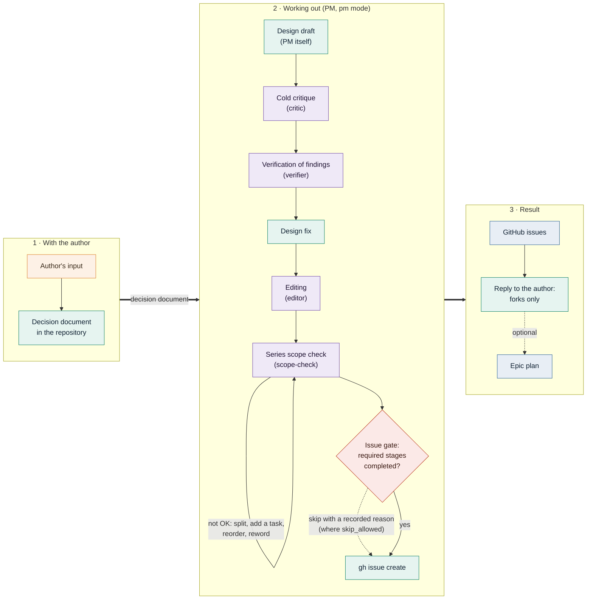

# Working out a task

How a task is worked out with Claude in the `pm` mode before it becomes GitHub issues or an
[epic](EPICS.md). Back to the [README](README.md).

Before an epic exists, the author and Claude in the `pm` mode work out the task. The bot does not run
the stages itself: in the `pm` mode it prepends a line to the message, "if this message starts or
continues working out a task, follow the PM runbook: read `<path>`", and Claude follows
`prompts/pm_runbook.md.dist` (or a local `prompts/pm_runbook.md`) inside its session. Epic runs get the
same line and follow the variant without an author: the stages that involve the author do not apply.



The set of stages comes from the pipeline config of the runbook (see below); an instance can change it.
The diagram shows the default config.

## Stages

1. **Author's input**: written word for word into the decision document in the repository.
2. **Design draft**: written by the PM itself, never delegated.
3. **Cold critique** (`critic`): an agent without the session's context attacks the draft.
4. **Verification** (`verifier`): every finding is checked against the facts (code, command output).
5. **Design fix**: for every confirmed finding; the analysis goes into the decision document.
6. **Editing** (`editor`): tightens the text without changing the listed load-bearing decisions.
7. **Series scope check** (`scope-check`): every pull request stays in scope, passes the CI gates of its
   repository, and the series has every prerequisite in the right order. Problems are fixed (split, add
   the missing task, reorder, reword) before any issue is opened.
8. **Issues**: opened from the checked task texts.
9. **Reply to the author**: only forks, each with an option, its consequence and a recommendation.

Agents are called synchronously (`run_in_background: false`).

## Built-in agents

The bot hands six read-only sub-agents to every Claude run (except the two phases of `/compact`) with
`--agents <file>`: `critic`, `verifier`, `editor`, `scope-check`, `acceptor` and `security`. Their bodies are
`prompts/agents/<name>.md.dist`. To override one:

- an agent with the same `name:` (the frontmatter value, not the file name) in `.claude/agents/*.md` of
  the managed repository or in `~/.claude/agents/*.md` of the bot's user wins: the bot does not pass the
  built-in agent of that name;
- if `CLAUDE_EXTRA_ARGS` already contains `--agents`, no built-in agents are passed and the reply carries
  a warning;
- to change only the body, put a local `prompts/agents/<name>.md` next to the `.dist` (the
  [`PromptFiles`](PROMPTS.md#overrides) mechanism). It replaces the whole file and must keep `name:`.

## Pipeline config

The first fenced `json` block of the runbook is the pipeline config:

```json
{
  "stages": [
    {"id": "critique", "agent": "critic", "required": true},
    {"id": "verify", "agent": "verifier", "required": true},
    {"id": "edit", "agent": "editor", "required": true},
    {"id": "scope", "agent": "scope-check", "required": true}
  ],
  "skip_allowed": {"pm": false, "review": true, "tick": false, "final": false, "epic_review": true}
}
```

- `stages`: the stages that call an agent, in order; each has an `id`, an `agent` and `required`.
- `skip_allowed`: per kind of run (`pm`, `review`, `tick`, `final`, `epic_review`) whether a required
  stage may be skipped. By default only `review` and `epic_review` allow it (side findings of a review).

The config is taken from `prompts/pm_runbook.md.dist`. A local `prompts/pm_runbook.md` replaces it as a
whole (a contract text: every run warns about the substitution). `PROMPTS_DIR/pm_runbook.md` is an
*addition*, like `epic.md`: its text is appended to the runbook, and its first `json` block, if any,
replaces `stages` entirely and overrides `skip_allowed` per kind of run. An invalid local
`prompts/pm_runbook.md` falls back to the `.dist` config; an invalid addition is dropped and the config
without it is used. The warning goes into the reply in the `pm` mode and into the log otherwise.

## The issue-creation gate

A `PreToolUse` hook on `Bash` in the `pm` and `review` modes (and in epic runs) refuses to create an issue
until the required stages ran. The `arch` mode is not covered.

- It catches `gh issue create` and `gh api repos/X/Y/issues` that creates an issue; comments
  (`.../issues/N/comments`) pass.
- A stage counts as done when the main chain of the transcript holds an `Agent` call with that
  `subagent_type` and `toolUseResult.status == "completed"`. Background calls do not count.
- Window: stage calls after the last successful issue creation that was followed by a message of the
  author. A series of issues created in one batch passes on one set of stages; the next design is
  checked again.
- Order: the last call of a stage is not earlier than the last call of the previous required stage.
- The config is a snapshot taken when the run starts; editing it inside the run does not affect the gate.
- Skipping: where `skip_allowed` is true for the kind of run, Claude writes the reason into the file named
  by the `WORKSPACE_ASSISTANT_PM_SKIP` environment variable and repeats the command; the bot shows the skip
  in the reply (or the log).
- The hook is fail-closed: if it fails, the command is blocked. Every deny is written to
  `<STATE_DIR>/pm-gate.log`.

Limits, stated plainly:

- The gate checks the process, not the verdict: that the stage agents were called, not that their
  findings were taken into account.
- Creating an issue with `curl` or GraphQL is not caught.
- The `arch` mode is not closed by the gate.

## Why write your own `scope-check`

The built-in `scope-check` is generic: CI gates of the target repository, one pull request one scope,
prerequisites and the order of the series. It cannot know the rules specific to your repository, and they
cannot be derived from the task text. Example: in a monorepo, a new package must first be added to an
allowlist by a separate task that is merged first. Without a step that knows this, the pull request fails
CI or goes out of scope. Plug in your own agent under the same `name:` in `.claude/agents/`, or assign
another agent to the `scope` slot in the pipeline config.
